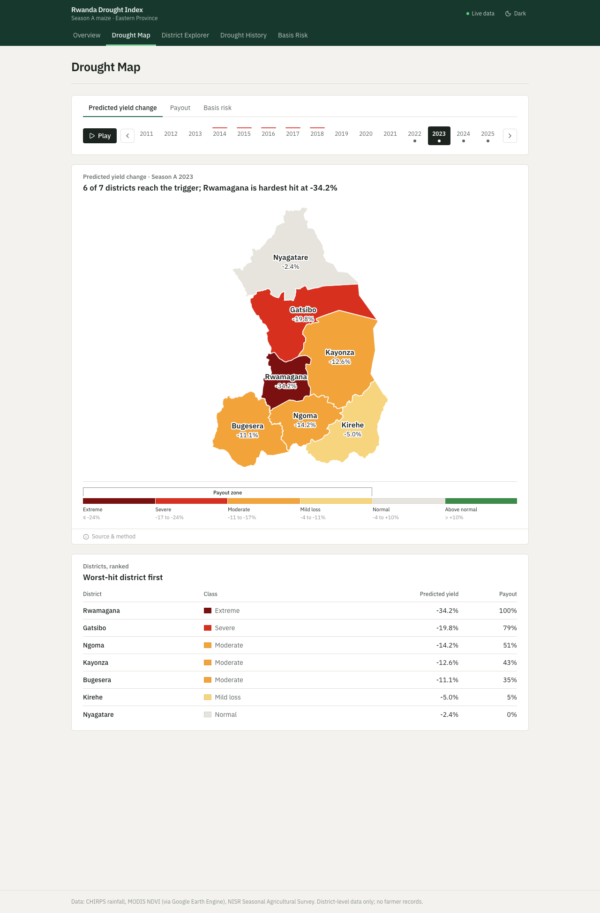
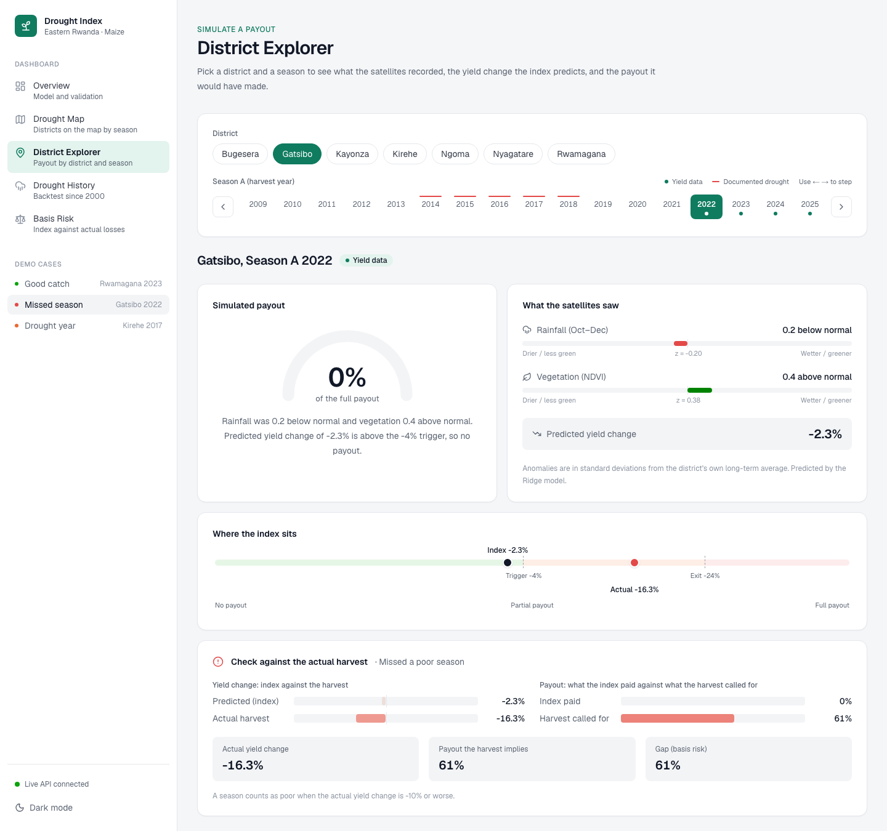
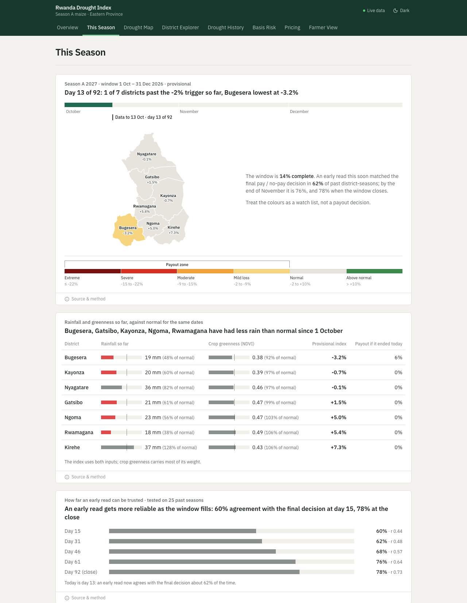
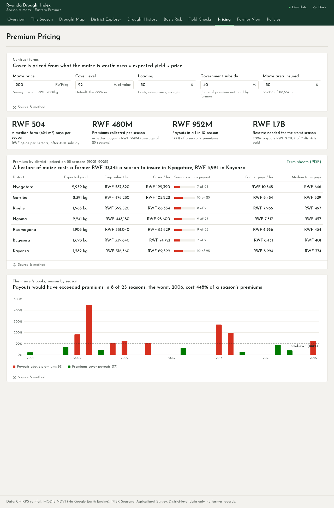
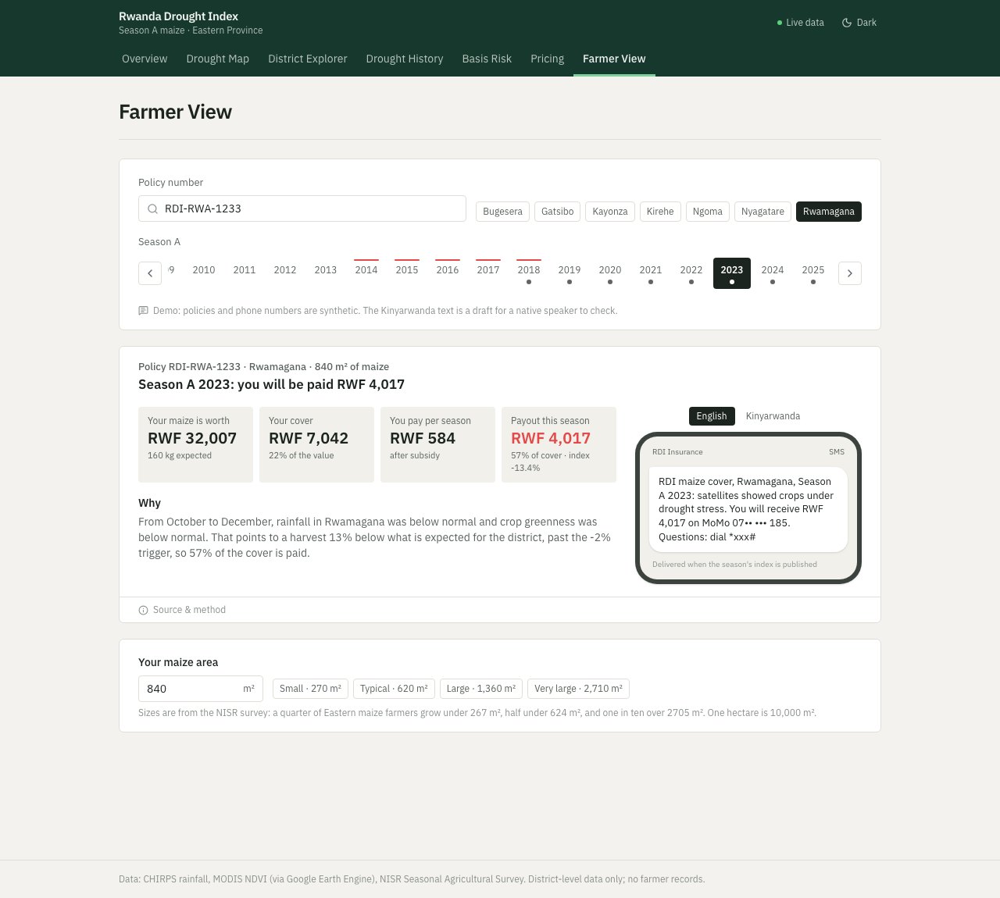

# Parametric Drought-Index Insurance Simulator

A web dashboard that simulates drought-index insurance payouts for smallholder maize farmers in
Eastern Rwanda. It combines satellite rainfall (CHIRPS) and vegetation (MODIS NDVI) into a
predicted yield change, calibrated against NISR district maize yields with a Ridge regression.
When the prediction falls below a trigger, a payout starts; every payout is shown with its
reason, and the gap between what the index pays and what farmers actually lost (basis risk) is
reported per district.

Scope: Season A maize, the seven districts of Eastern Province (Bugesera, Gatsibo, Kayonza,
Kirehe, Ngoma, Nyagatare, Rwamagana), backtested from 2001 to 2025.

## Links

- **GitHub repository:** https://github.com/JokMaker/parametric-drought-simulator
- **Video demo:** [Watch the demo video](https://drive.google.com/drive/folders/1JapZ7DmX66B_u9T2FLEXRqJZKYc-LBBm?usp=drive_link)
- **Figma designs:** [Open the Figma file](https://www.figma.com/design/b7m0ZzV4ZXdzikU7GOhHUG/Drought-Index-Simulator-%E2%80%93-Designs?node-id=0-1)

## Features

| Page | What it does | Requirements |
|---|---|---|
| **Overview** | Opens with a four-step picture of how the index works and a five-stop guided tour on the map (a normal year, the worst year, a drought caught, a drought missed, a false alarm), then a scatter plot of the index against the actual harvest for all 56 district-seasons; then the selected model, trigger (−2%) and exit (−22%), hit rate (50%) and false payout rate (22%), validation results (leave-one-out and leave-one-season-out), and which input drives the index | FR7, FR8, FR9 |
| **This Season** | Follows the Season A window in progress (now October–December 2026) with near-real-time data: rainfall from NASA GPM IMERG and crop greenness from MODIS daily reflectance, each against the same dates in every season since 2001. Shows a provisional index per district on a map, rainfall and greenness so far against normal, and how far an early read can be trusted (tested on 25 past seasons: 60% agreement with the final decision by mid-October, 78% at the close). Refresh with `notebook/jok/bin/python notebook/update_current_season.py` | — |
| **Drought Map** | The seven districts on a map, coloured by the predicted yield change, the payout or the basis risk for any season since 2001. Press Play to watch every season from 2001 in turn. Hover a district for its rainfall and greenness anomalies, index and payout; click it to open it in the Explorer | FR1, FR3, FR5, FR10 |
| **District Explorer** | Pick a district and season; see rainfall and vegetation anomalies, a payout gauge, where the index sits between trigger and exit, and the reason for the payout. For 2018–2025 the index and payout are shown side by side with the actual harvest | FR1, FR3, FR5, FR6, FR7, FR9 |
| **Drought History** | The index and payout for every year since 2000, with documented drought years (2003–2006, 2013–2017) shaded, and a district-by-year heatmap: payouts in 54% of drought-year seasons against 23% of other years | FR9 |
| **Basis Risk** | A "what if" simulator: move the trigger and exit and see how many poor harvests are paid, how many are missed, the false payouts and the basis risk change live. Then basis risk per district (Nyagatare 33% highest, Kayonza 18% lowest) and a season-by-season table filterable by outcome (missed, false payout, paid correctly) | FR10 |
| **Pricing** | Prices the cover from what the maize is worth: maize area × expected yield × price (RWF 200/kg, the NISR farm-gate median). Set the cover level, loading, subsidy and share of the 118,687 ha insured; see the premium per hectare and for a median farm in each district, premiums against expected payouts, the 1-in-10 season, the reserve needed for the worst season (2006), and a loss ratio for every season since 2001 | — |
| **Farmer View** | Look up a synthetic demo policy, enter the maize area, and see the crop's value, the cover, the premium and the payout for any season, with the SMS the farmer would receive in English or Kinyarwanda (draft). When the district is not paid, the farmer can report a crop loss, the route for losses the satellites miss | — |

## Machine learning model

The model is built in [notebook/drought_index.ipynb](notebook/drought_index.ipynb), which runs locally (see [Run the notebook](#run-the-notebook)).

| Item | Summary |
|---|---|
| **Data engineering** | CHIRPS rainfall and MODIS NDVI clipped to the 7 districts, masked to cropland, aggregated over the October–December window and turned into z-scores against each district's history; NISR survey plots filtered to smallholder maize and aggregated into survey-weighted district yields, from nine Season A releases (2017–2025) in four file layouts; 2024 rebuilt by joining the raw Production and Screening files, 2021's maize area joined from Screening. Yields are detrended (+9.3% a year) before computing anomalies. Result: 56 district-seasons (2018–2025) for training, 175 for the backtest. 2017 is kept but not trained on (NISR imputed most of its production); 2013–2016 cannot be used (no harvest quantities in the microdata). |
| **Visualizations** | Distributions, scatter plots, correlation matrix, yields by district, seasonal NDVI and cloud-cover profiles, peak-NDVI sensitivity, predicted vs actual, residuals, confusion matrix, trigger selection, drought-year backtest |
| **Architecture** | 2 inputs (rainfall and vegetation anomalies) → `StandardScaler` → Ridge regression (L2 penalty, α = 6.25 tuned by nested leave-one-out) → predicted yield change → payout rule (−2% trigger, −22% exit). Compared against Lasso, quadratic OLS and a mean-only baseline; Ridge and Lasso are tied (R² within 0.02 under both schemes). Crop greenness carries 93% of the weight. |
| **Regression metrics** (leave-one-out) | RMSE 22.26, MAE 17.31, predictive R² 0.11 (baseline: RMSE 24.09, R² −0.04). For an unseen year (leave-one-season-out) R² is −0.11: the index does not yet predict a new season's level. The earlier 0.51, from 2022–2025 alone, came mostly from the yield trend over those four seasons. |
| **Payout-decision metrics** | Accuracy 70%, precision 47%, recall (hit rate) 50%, F1 48%, false payout rate 22% |
| **Backtest** | Payouts in 54% of documented drought-year seasons against 23% of other years (2.3×) |
| **Deployment** | Exported to `backend/data/` and served by the FastAPI backend (Swagger UI at `/docs`) and the Next.js dashboard |

## Tech stack

| Layer | Tools |
|---|---|
| Frontend | Next.js 16 (App Router), React 19, TypeScript, Tailwind CSS 4, Recharts, d3-geo (map), lucide-react |
| Backend | Python 3.12, FastAPI, Pydantic, Uvicorn, pytest |
| Model and data | scikit-learn Ridge regression (trained in the project notebook), Google Earth Engine (CHIRPS, MODIS), NISR Seasonal Agricultural Survey |
| Deployment | Docker, Docker Compose |

## Set up and run

### Prerequisites

- Node.js 20 or later and npm
- Python 3.12 or later
- Docker Desktop (only for the Docker option)

### Option 1: Docker (one command)

```bash
git clone https://github.com/JokMaker/parametric-drought-simulator.git
cd parametric-drought-simulator
docker compose up --build
```

- Dashboard: http://localhost:3000
- API documentation (Swagger UI): http://localhost:8000/docs

### Option 2: Run locally (two terminals)

**Terminal 1: backend**

```bash
cd backend
python3 -m venv .venv
source .venv/bin/activate
pip install -r requirements-dev.txt
uvicorn app.main:app --reload --port 8000
```

**Terminal 2: frontend**

```bash
cd frontend
npm install
cp .env.example .env.local
npm run dev
```

Open http://localhost:3000. The header shows **Live data** when the dashboard is
reading from the backend. With `NEXT_PUBLIC_USE_MOCK=true` the dashboard runs without the backend
on the saved notebook results.

### Run the tests

```bash
cd backend
source .venv/bin/activate
python -m pytest
```

The 13 tests check the API against the notebook: the index formula on all 175 district-seasons,
the leave-one-out results, the hit and false payout rates, the drought-year totals (34/63 against
26/112) and basis risk for every district.

### Run the notebook

The notebook rebuilds the model from raw data and writes its results into `backend/data/`.

1. Put the NISR files in `data/nisr/` (they are git-ignored and never committed):
   `season_a_2022.sav`, `season_a_2023.csv`, `season_a_2025.csv`,
   `2024_extra/Rwa_raw_SeasonA2024_Production.csv` and `..._Screening.csv`, and the Stata
   files for 2017–2021 in `2017/` … `2021/` (Season A Crop production and Screening; the
   notebook's Section 6c lists each file).
2. Install and open:
   ```bash
   python3 -m venv notebook/jok
   notebook/jok/bin/pip install -r notebook/requirements.txt
   ```
   then open `notebook/drought_index.ipynb` in VS Code or Jupyter, choose `notebook/jok` as the kernel, and run all cells. The first run
   asks you to sign in to Google Earth Engine; satellite extracts are cached in `data/`.
3. Refresh the dashboard's offline data: `cd backend && .venv/bin/python scripts/export_mock.py`.
4. During the October–December window, refresh the This Season page with
   `notebook/jok/bin/python notebook/update_current_season.py` (about a minute; add `--skill-curve` to redo the
   reliability test, a few minutes). It needs the same Earth Engine sign-in as the notebook.

## Designs

**Figma file:** [Drought Index Simulator – Designs](https://www.figma.com/design/b7m0ZzV4ZXdzikU7GOhHUG/Drought-Index-Simulator-%E2%80%93-Designs?node-id=0-1). It holds editable designs of every
page (Overview, District Explorer for Rwamagana 2023 and Gatsibo 2022, Drought History, Basis Risk),
plus mobile and dark-mode versions, with the app's colour and text styles saved as Figma styles. The Figma file shows the earlier
sidebar design; the screenshots below show the current one.

The interface is built for an analyst or programme officer (proposal NFR3), so every number is
paired with a plain-language label and every payout with the reason for it.

**Design decisions**

The layout follows public drought and climate dashboards rather than a generic app template:
the [U.S. Drought Monitor](https://droughtmonitor.unl.edu/), [drought.gov](https://www.drought.gov/current-conditions)
and [Our World in Data](https://ourworldindata.org/). The supervisor's 13th feedback asked for
cards that stack vertically, each on its own, and charts that each tell a story.

- **Navigation:** a dark header bar with the five pages as tabs and a live/offline data indicator.
  On phones the tabs scroll sideways.
- **One column of cards:** each page is a single column, one card per finding. A short row of key
  figures sits at the top of a page, as on drought.gov.
- **Every card title is the finding**, not the chart name. "6 of 7 districts reach the trigger;
  Rwamagana is hardest hit" or "Payouts cluster in documented droughts: 54% of drought seasons
  against 23% of others". The titles are computed from the data, so they change with the season or
  district chosen. A small label above names what is shown, and a source line closes each card.
- **Severity classes like the Drought Monitor's D0–D4:** the predicted yield change is shown in
  labelled classes tied to the payout rule: gain, near normal (no payout), then watch, moderate and
  severe as thirds between the trigger and the exit, and extreme (full payout). Payouts and
  basis risk have their own labelled class scales (basis risk in purple). Every coloured chart has a
  class legend with the range of each class, so no value depends on colour alone.
- **The charts explain themselves, not the text:** following practitioner research on annotation
  ([Rahman et al., 2026](https://arxiv.org/html/2604.07691)), labels sit on the chart next to what
  they name. The scatter names its four outcomes in their corners, the payout bar names its three
  zones and pins the index and the real harvest, drought periods are labelled on the time charts,
  and counts are drawn as dots. The Overview opens with a four-step picture of how the index works.
  Method notes are folded under "Source & method" on each card, so they are there for a reviewer
  without crowding the view.
- **Learn by doing, not by reading:** three interactive features replace written explanation.
  A guided tour on the Overview steps through five seasons picked from the data, an approach shown
  to onboard first-time dashboard users well ([D-Tour, IEEE VIS 2024](https://jku-vds-lab.at/publications/2025_d-tour/)).
  A trigger simulator on Basis Risk lets the reader test the trade-off between missed seasons and
  false payouts themselves, as index insurers let clients simulate payouts
  ([Arbol](https://www.arbol.io/post/how-parametric-insurance-pricing-works)). The Drought Map
  plays through every season, so droughts can be watched spreading and clearing.
- **Explorer controls:** district buttons and a season timeline replace dropdowns, so every option
  is visible. Seasons with yield data and documented drought years are marked on the timeline, and
  the arrow keys step through years. The selection is kept in the URL, so any view can be shared.
  The Explorer ends with the selected season placed among all 25 seasons for that district.
- **Light and dark mode** follow the system setting, with a manual toggle.
- **Responsive layout** from phone to desktop.

### Overview


### Drought Map


### District Explorer: a good catch (Rwamagana 2023)


### District Explorer: a missed season (Gatsibo 2022)


### Drought History


### Basis Risk


### This Season


### Pricing


### Farmer View


### Dark mode and mobile
| Dark mode | Mobile |
|---|---|
|  |  |

### API (Swagger UI)


## Architecture

```
Browser ──► Next.js dashboard (port 3000)
               │  fetch JSON
               ▼
            FastAPI backend (port 8000) ──► calibrated model + results (backend/data/)
                                                ▲
                          exported from the calibration notebook
                          (CHIRPS + MODIS via Google Earth Engine, NISR yields)
```

The calibration (Ridge regression, leave-one-out validation, trigger and exit) runs once in the
notebook ([notebook/drought_index.ipynb](notebook/drought_index.ipynb)) and is exported, so the API only serves precomputed results and applies the saved
formula. This keeps every request fast (NFR1) and the thresholds reproducible (NFR5).

### API endpoints

| Endpoint | Returns |
|---|---|
| `GET /api/model` | Model, coefficients, trigger, exit, low-yield threshold, hit and false payout rates, validation |
| `GET /api/simulate?district=Gatsibo&season=2022` | Anomalies, predicted yield change, payout, and (for 2018–2025) the actual yield and the payout it implies |
| `GET /api/history` | Index and payout for every district and year since 2000 |
| `GET /api/basis-risk` | Basis risk per district |
| `GET /api/seasons` | The 56 calibration district-seasons |
| `GET /api/geo/districts` | District boundaries (FAO GAUL 2025, simplified GeoJSON) for the map |
| `GET /api/health` | Service status |

### Index formula

For seasons without yield data the backend computes the index from the saved model
(`backend/app/model.py`):

```
index  = intercept + Σ coefficient_i × (z_i − scaler_mean_i) / scaler_scale_i     z = (rain_z, ndvi_z)
payout = 0 above the −2% trigger, 1 at or below the −22% exit, linear in between
```

For 2018–2025 it uses the leave-one-out prediction, so the comparison with the actual
harvest is honest (the model never saw that season).

## Data model

The prototype loads the notebook export into memory. All data is district-level; no farmer
records are stored or processed (proposal §1.7).

| File | Contents |
|---|---|
| `model.json` | Scaler, Ridge coefficients and intercept, trigger, exit, low-yield threshold, hit and false payout rates, validation results |
| `calibration.csv` | `district, season, yield_kg_ha, yield_anom, rain_z, ndvi_z, index_loo, payout, payout_if_actual, basis_risk` (56 rows) |
| `eastern_districts.geojson` | The seven district boundaries (FAO GAUL 2025, simplified to about 200 m), exported by the notebook for the map |
| `seasons.csv` | `district, season, window_year, rain_mm, ndvi, rain_z, ndvi_z, index, payout, drought_year` (one row per district-season) |

The PostgreSQL schema planned in the proposal (§3.5, Figure 6) maps these files onto four tables:

```
district            (district_id PK, name, province)
climate_record      (record_id PK, district_id FK, season, window_year, rain_mm, ndvi, rain_z, ndvi_z)
yield_record        (record_id PK, district_id FK, season, yield_kg_ha, yield_anom)
payout_simulation   (simulation_id PK, district_id FK, season, index_value, payout,
                     payout_if_actual, trigger, exit)
```

With 56 calibration rows and 175 history rows, in-memory files meet the performance and
reproducibility requirements for the prototype; the database is introduced in the deployment
phase below.

## Deployment plan

| Stage | Plan |
|---|---|
| **Now (local)** | Both services run with `docker compose up --build`, or separately for development. |
| **Backend hosting** | Deploy `backend/Dockerfile` to a container host with a free tier (Render or Railway). Set `CORS_ORIGINS` to the dashboard's URL. |
| **Frontend hosting** | Deploy `frontend/` to Vercel. Set `NEXT_PUBLIC_API_URL` to the backend URL and `NEXT_PUBLIC_USE_MOCK=false` at build time. |
| **Database** | Add a managed PostgreSQL instance (Render, Railway or Supabase free tier) with the schema above, loaded from the notebook export by a one-off script. |
| **Updates** | Re-running the notebook writes the three files into `backend/data/`; then run `python backend/scripts/export_mock.py` to refresh the dashboard's offline data, update the tests' expected values, and redeploy. |

## Project structure

```
parametric-drought-simulator/
├── backend/
│   ├── app/            FastAPI app: routes (main.py), data loading, model formula, schemas
│   ├── data/           Notebook export: model.json, calibration.csv, seasons.csv
│   ├── tests/          API tests against the notebook results
│   └── Dockerfile
├── frontend/
│   ├── app/            Pages: overview, explorer, history, basis-risk
│   ├── components/     Top navigation, payout cards, charts, shared UI
│   ├── lib/            API client, types, payout logic, constants
│   └── Dockerfile
├── notebook/           Calibration notebook: data extraction, the 2024 reconstruction, EDA,
│                       model comparison, trigger and exit, drought-year check, export
├── data/               Cached satellite extracts and district yields (raw NISR files in
│                       data/nisr/ are git-ignored)
├── docs/screenshots/   Interface screenshots used above
└── docker-compose.yml
```

## Data and privacy

Raw NISR survey files are excluded from the repository (`data/nisr/`, `*.sav` in `.gitignore`):
they are used for academic calibration only and are not redistributed (proposal §1.7.2). The
files in `backend/data/` contain district-level aggregates only.
