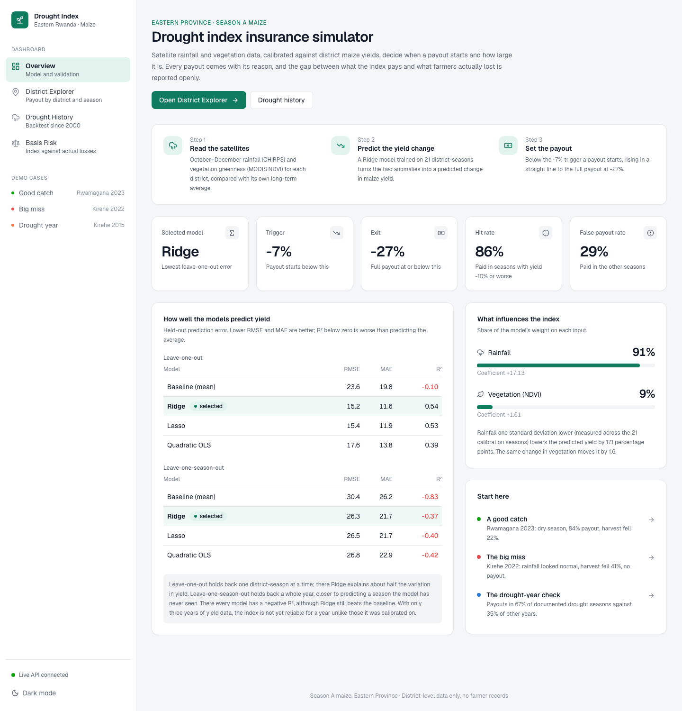
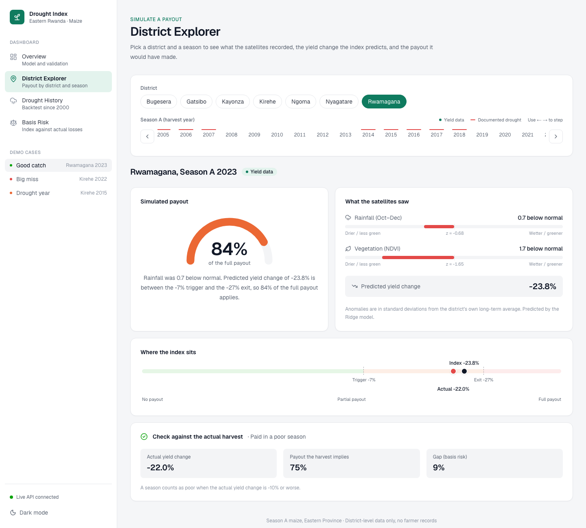
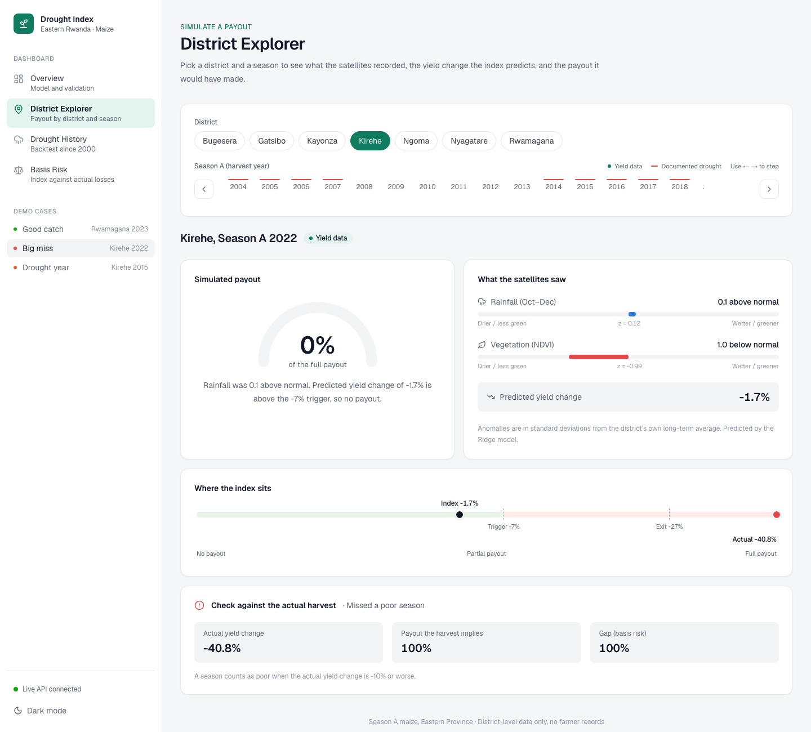
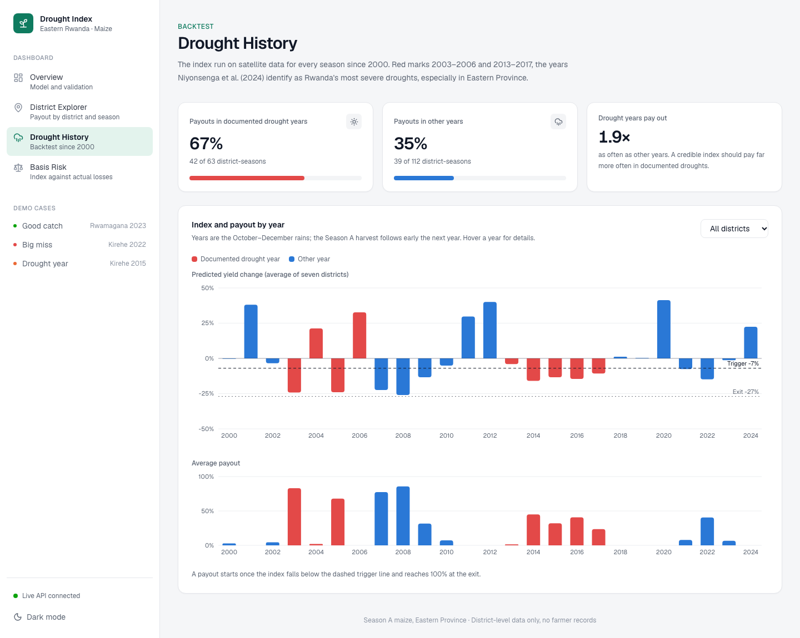
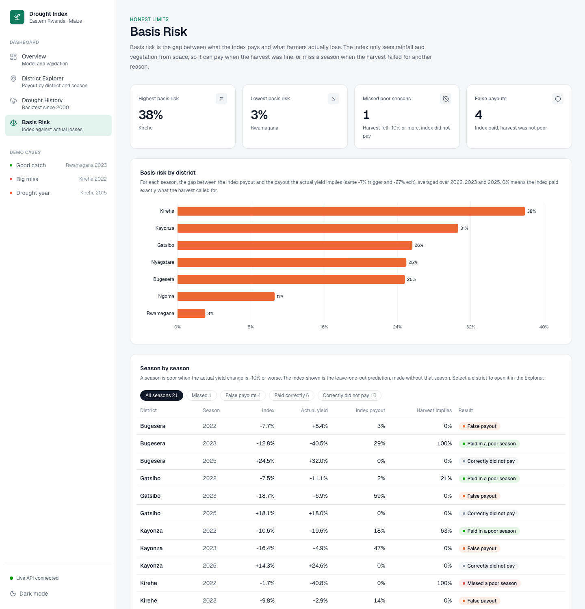
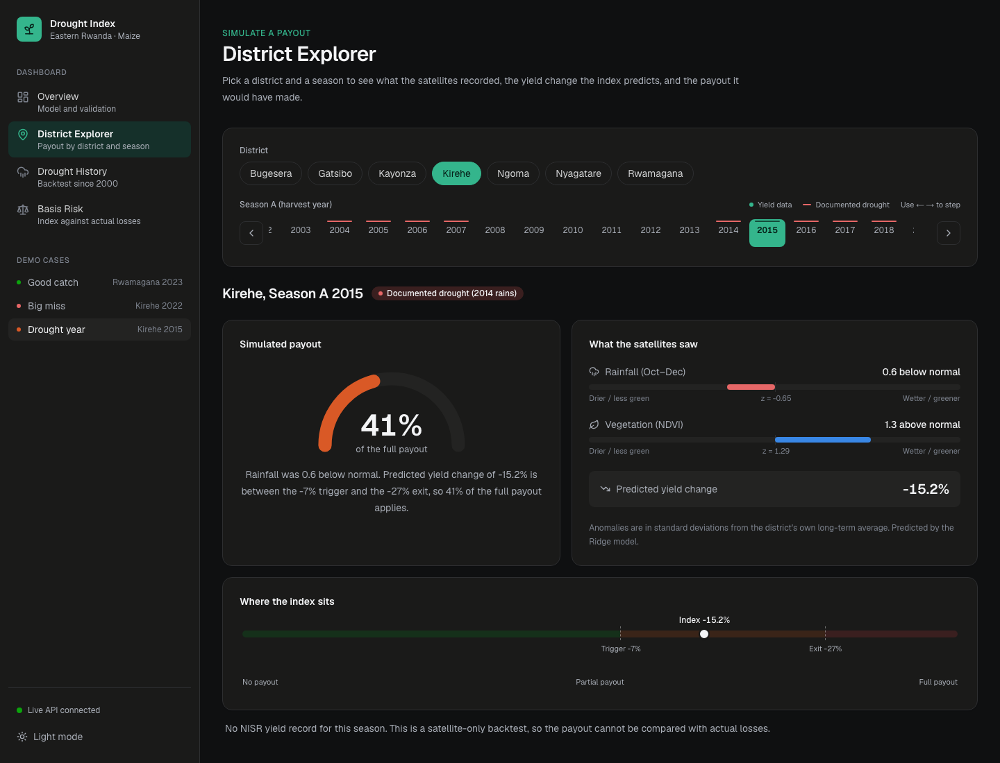
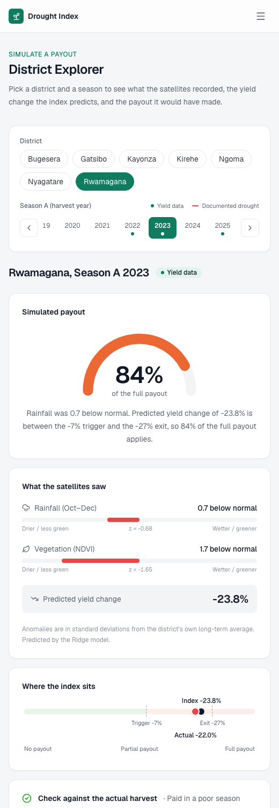
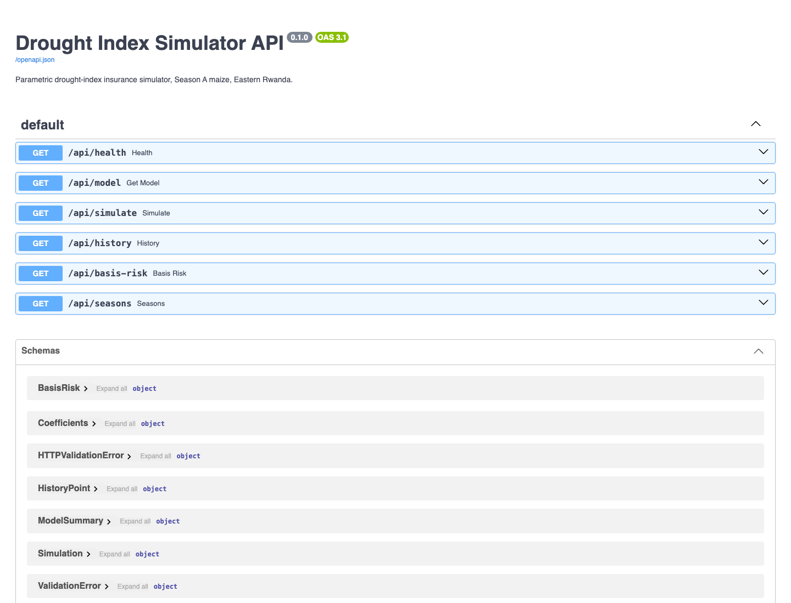

# Parametric Drought-Index Insurance Simulator

A web dashboard that simulates drought-index insurance payouts for smallholder maize farmers in
Eastern Rwanda. It combines satellite rainfall (CHIRPS) and vegetation (MODIS NDVI) into a
predicted yield change, calibrated against NISR district maize yields with a Ridge regression.
When the prediction falls below a trigger, a payout starts; every payout is shown with its
reason, and the gap between what the index pays and what farmers actually lost (basis risk) is
reported per district.

Scope: Season A maize, the seven districts of Eastern Province (Bugesera, Gatsibo, Kayonza,
Kirehe, Ngoma, Nyagatare, Rwamagana), backtested from 2001 to 2025.

## Links

- **GitHub repository:** https://github.com/JokMaker/parametric-drought-simulator
- **Video demo:** [Google Drive folder](https://drive.google.com/drive/folders/1JapZ7DmX66B_u9T2FLEXRqJZKYc-LBBm?usp=drive_link)

## Features

| Page | What it does | Requirements |
|---|---|---|
| **Overview** | Selected model, trigger (−7%) and exit (−27%), hit rate (86%) and false payout rate (29%), validation results (leave-one-out and leave-one-season-out), and which input drives the index | FR7, FR8 |
| **District Explorer** | Pick a district and season; see rainfall and vegetation anomalies, the predicted yield change, the payout and the reason for it. For 2022, 2023 and 2025 the payout is compared with the actual harvest | FR1, FR3, FR5, FR6, FR7, FR9 |
| **Drought History** | The index and payout for every year since 2000, with documented drought years (2003–2006, 2013–2017) highlighted: payouts in 67% of drought-year seasons against 35% of other years | FR9 |
| **Basis Risk** | Basis risk per district (Kirehe 38% highest, Rwamagana 3% lowest) and a season-by-season table filterable by outcome (missed, false payout, paid correctly) | FR10 |

## Tech stack

| Layer | Tools |
|---|---|
| Frontend | Next.js 16 (App Router), React 19, TypeScript, Tailwind CSS 4, Recharts, lucide-react |
| Backend | Python 3.12, FastAPI, Pydantic, Uvicorn, pytest |
| Model and data | scikit-learn Ridge regression (trained in the project notebook), Google Earth Engine (CHIRPS, MODIS), NISR Seasonal Agricultural Survey |
| Deployment | Docker, Docker Compose |

## Set up and run

### Prerequisites

- Node.js 20 or later and npm
- Python 3.12 or later
- Docker Desktop (only for the Docker option)

### Option 1: Docker (one command)

```bash
git clone https://github.com/JokMaker/parametric-drought-simulator.git
cd parametric-drought-simulator
docker compose up --build
```

- Dashboard: http://localhost:3000
- API documentation (Swagger UI): http://localhost:8000/docs

### Option 2: Run locally (two terminals)

**Terminal 1: backend**

```bash
cd backend
python3 -m venv .venv
source .venv/bin/activate
pip install -r requirements-dev.txt
uvicorn app.main:app --reload --port 8000
```

**Terminal 2: frontend**

```bash
cd frontend
npm install
cp .env.example .env.local
npm run dev
```

Open http://localhost:3000. The sidebar shows **Live API connected** when the dashboard is
reading from the backend. With `NEXT_PUBLIC_USE_MOCK=true` the dashboard runs without the backend
on the saved notebook results.

### Run the tests

```bash
cd backend
source .venv/bin/activate
python -m pytest
```

The 11 tests check the API against the notebook: the index formula on all 175 district-seasons,
the leave-one-out results, the hit and false payout rates, the drought-year totals (42/63 against
39/112) and basis risk for every district.

## Designs

The interface is built for an analyst or programme officer (proposal NFR3), so every number is
paired with a plain-language label and every payout with the reason for it.

**Design decisions**

- **Navigation:** a persistent sidebar lists the four pages with a one-line description each,
  plus one-click demo cases and a live/offline API indicator. On phones it collapses into a menu.
- **Explorer controls:** district chips and a season timeline replace dropdowns, so every option
  is visible. Seasons with yield data and documented drought years are marked on the timeline, and
  the arrow keys step through years. The selection is kept in the URL, so any view can be shared.
- **Colour:** red for documented drought years and blue for other years, checked for colour-blind
  separation and contrast in both light and dark mode. Status colours always come with a text
  label, never colour alone.
- **Light and dark mode** follow the system setting, with a manual toggle.
- **Responsive layout** from phone to desktop.

### Overview


### District Explorer: a good catch (Rwamagana 2023)


### District Explorer: the big miss (Kirehe 2022)


### Drought History


### Basis Risk


### Dark mode and mobile
| Dark mode | Mobile |
|---|---|
|  |  |

### API (Swagger UI)


## Architecture

```
Browser ──► Next.js dashboard (port 3000)
               │  fetch JSON
               ▼
            FastAPI backend (port 8000) ──► calibrated model + results (backend/data/)
                                                ▲
                          exported from the calibration notebook
                          (CHIRPS + MODIS via Google Earth Engine, NISR yields)
```

The calibration (Ridge regression, leave-one-out validation, trigger and exit) runs once in the
notebook and is exported, so the API only serves precomputed results and applies the saved
formula. This keeps every request fast (NFR1) and the thresholds reproducible (NFR5).

### API endpoints

| Endpoint | Returns |
|---|---|
| `GET /api/model` | Model, coefficients, trigger, exit, low-yield threshold, hit and false payout rates, validation |
| `GET /api/simulate?district=Kirehe&season=2022` | Anomalies, predicted yield change, payout, and (for 2022, 2023, 2025) the actual yield and the payout it implies |
| `GET /api/history` | Index and payout for every district and year since 2000 |
| `GET /api/basis-risk` | Basis risk per district |
| `GET /api/seasons` | The 21 calibration district-seasons |
| `GET /api/health` | Service status |

### Index formula

For seasons without yield data the backend computes the index from the saved model
(`backend/app/model.py`):

```
index  = intercept + Σ coefficient_i × (z_i − scaler_mean_i) / scaler_scale_i     z = (rain_z, ndvi_z)
payout = 0 above the −7% trigger, 1 at or below the −27% exit, linear in between
```

For 2022, 2023 and 2025 it uses the leave-one-out prediction, so the comparison with the actual
harvest is honest (the model never saw that season).

## Data model

The prototype loads the notebook export into memory. All data is district-level; no farmer
records are stored or processed (proposal §1.7).

| File | Contents |
|---|---|
| `model.json` | Scaler, Ridge coefficients and intercept, trigger, exit, low-yield threshold, hit and false payout rates, validation results |
| `calibration.csv` | `district, season, yield_kg_ha, yield_anom, rain_z, ndvi_z, index_loo, payout, payout_if_actual, basis_risk` (21 rows) |
| `seasons.csv` | `district, season, window_year, rain_mm, ndvi, rain_z, ndvi_z, index, payout, drought_year` (one row per district-season) |

The PostgreSQL schema planned in the proposal (§3.5, Figure 6) maps these files onto four tables:

```
district            (district_id PK, name, province)
climate_record      (record_id PK, district_id FK, season, window_year, rain_mm, ndvi, rain_z, ndvi_z)
yield_record        (record_id PK, district_id FK, season, yield_kg_ha, yield_anom)
payout_simulation   (simulation_id PK, district_id FK, season, index_value, payout,
                     payout_if_actual, trigger, exit)
```

With 21 calibration rows and 175 history rows, in-memory files meet the performance and
reproducibility requirements for the prototype; the database is introduced in the deployment
phase below.

## Deployment plan

| Stage | Plan |
|---|---|
| **Now (local)** | Both services run with `docker compose up --build`, or separately for development. |
| **Backend hosting** | Deploy `backend/Dockerfile` to a container host with a free tier (Render or Railway). Set `CORS_ORIGINS` to the dashboard's URL. |
| **Frontend hosting** | Deploy `frontend/` to Vercel. Set `NEXT_PUBLIC_API_URL` to the backend URL and `NEXT_PUBLIC_USE_MOCK=false` at build time. |
| **Database** | Add a managed PostgreSQL instance (Render, Railway or Supabase free tier) with the schema above, loaded from the notebook export by a one-off script. |
| **Updates** | When the notebook is re-run, replace the three files in `backend/data/` (or reload the database) and redeploy; the tests confirm the API still matches the notebook. |

## Project structure

```
parametric-drought-simulator/
├── backend/
│   ├── app/            FastAPI app: routes (main.py), data loading, model formula, schemas
│   ├── data/           Notebook export: model.json, calibration.csv, seasons.csv
│   ├── tests/          API tests against the notebook results
│   └── Dockerfile
├── frontend/
│   ├── app/            Pages: overview, explorer, history, basis-risk
│   ├── components/     Sidebar, payout panel, charts, shared UI
│   ├── lib/            API client, types, payout logic, constants
│   └── Dockerfile
├── docs/screenshots/   Interface screenshots used above
└── docker-compose.yml
```

## Data and privacy

Raw NISR survey files are excluded from the repository (`data/nisr/`, `*.sav` in `.gitignore`):
they are used for academic calibration only and are not redistributed (proposal §1.7.2). The
files in `backend/data/` contain district-level aggregates only.
